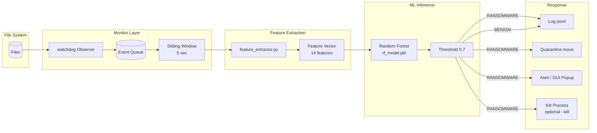

# SYNOPSIS

## Ransomware Detection System using Machine Learning and Behavioral Analysis

---

## 1. Title

**Ransomware Detection System using Machine Learning and Behavioral Analysis**

---

## 2. Objective

The objective of this project is to design, implement, and evaluate a real-time
ransomware detection system that monitors file-system activity, extracts
behavioral features, and classifies activity as BENIGN or RANSOMWARE using a
supervised Machine Learning model, with automated response actions
(alerting, quarantine, and optional process termination) and a live GUI
dashboard.

---

## 3. Problem Statement

Ransomware remains one of the most damaging cyber threats, encrypting victim
data and demanding payment. Signature-based antivirus solutions fail against
polymorphic and fileless ransomware variants because their hashes change with
every sample. There is a need for a detection approach that identifies ransomware
by **what it does** (behavior) rather than **what it looks like** (signature).

Key challenges addressed:

1. **Zero-day variants**: new ransomware families have no known signatures.
2. **Encryption is legitimate behavior**: many benign tools (backup, archiving)
   also write many files — the detector must separate these from attacks.
3. **Speed**: detection must occur within seconds, while the attack is still
   in progress, to enable containment (quarantine) before all data is lost.

---

## 4. Motivation

- Ransomware damages are estimated in **billions of dollars annually**, affecting
  hospitals, schools, governments, and enterprises.
- The 2017 WannaCry attack infected ~200,000 computers across 150 countries.
- Modern ransomware uses **polymorphism** (changing file hashes) to evade
  signature-based detection.
- **Behavioral analysis** observes filesystem side-effects (entropy spikes,
  mass renames, ransom-note drops) that are inherent to the encryption process
  and hard for attackers to hide without breaking the attack itself.
- ML classifiers can combine multiple weak behavioral signals into a strong
  detection decision, adapting to variants that keep the same behavior.

---

## 5. Literature Review

| # | Work / Solution | Approach | Limitation addressed by this project |
|---|-----------------|----------|--------------------------------------|
| 1 | **Canali et al. (2018)** — *Prophylactic Black-Box Detection of Ransomware* (DTRAP) | Entropy-based detection: monitors entropy of files written by a process; ransomware produces high-entropy output | Entropy alone gives false positives on compressors/backups → we combine entropy with rename rate, extension changes, and ransom-note IOCs |
| 2 | **Continella et al. (2016)** — *Falcon: File-Level Monitoring* (ACSAC) | Logs file-level events (open/write/rename/delete) and classifies programs by behavior | Falcon is program-centric and complex to deploy → we use a simpler sliding-window feature vector over watchdog events |
| 3 | **Meahnaz / behavioral-clustering line of work (e.g., Alhawi et al. 2018)** | Clustering of file-system behavior traces to separate ransomware from benign | Unsupervised clustering needs labeled data tuning → we use supervised Random Forest with labeled synthetic+realistic features |
| 4 | **Ucci, Aniello & Baldoni (2019)** — *Survey of Machine Learning Techniques for Malware Analysis* (Computers & Security) | Comprehensive survey of ML for malware, including ransomware | Survey notes feature-selection issues → we perform feature-importance analysis and document the top behavioral features |
| 5 | **Pendlebury et al. (2019)** — *Telling Bees: Exploring Equivalence of Crypto-Ransomware Detection* (DIMVA) | Shows dynamic crypto-ransomware detectors are largely equivalent across families | Detector equivalence implies behavior features generalize → our feature set targets the universal crypto-ransomware behavior (encrypt+rename+note) |
| 6 | **Sgandurra et al. (2016)** — *Elastic, Automatic Ransomware Detection* (FALCON vs. AutoWannacry) | Automated evaluation of ransomware detectors against real families | Manual evaluation does not scale → we build a **safe simulator** for repeatable, automated demonstration and regression testing |

**Summary**: prior art validates behavior-based detection, but many systems are
heavyweight (kernel hooks, full syscall tracing) or evaluated only offline.
This project contributes a lightweight, end-to-end, demonstrable system:
watchdog-based monitoring + engineered behavioral features + Random Forest /
XGBoost classification + live response, runnable on Windows in minutes.

---

## 6. Proposed Methodology

**Pipeline stages:**

1. **Monitoring**: `watchdog` observes create/modify/delete/move events on a
   target folder, converting them to structured `FileEvent` objects.
2. **Sliding window**: events are aggregated into a 5-second window.
3. **Feature extraction** (14 features): entropy statistics, event rates
   (create/modify/delete/rename per second), extension-change rate, suspicious
   extension ratio, bytes-written rate, ransom-note detection, event count.
4. **Classification**: Random Forest (primary) and XGBoost (comparison) predict
   BENIGN vs RANSOMWARE; probability ≥ 0.7 ⇒ RANSOMWARE.
5. **Response**: JSONL logging, quarantine (move suspicious files), GUI alert;
   process-kill available only via explicit `--kill` flag.
6. **Ground-truth generation**: a safe simulator reproduces crypto-ransomware
   TTPs (burst create → encrypt → mass rename → ransom note) strictly inside a
   sandboxed `test_folder/`.

### Behavioral Features (feature vector)

| Feature | Ransomware signature |
|---------|----------------------|
| entropy_avg / entropy_max | Encryption pushes file entropy toward 8.0 |
| file_create_rate | Burst of new files (staging/encryption) |
| file_modify_rate | In-place encryption of existing files |
| rename_rate | Mass rename to attacker extension (e.g. `.locked`) |
| extension_change_rate | Legitimate extension replaced |
| suspicious_ext_ratio | Fraction of files using known ransom extensions |
| bytes_written_rate | High write throughput during encryption |
| ransom_note_detected | README/decrypt note dropped |
| unique_extensions_new | Low diversity (single ransom extension) |
| event_count / time_window_sec | Activity intensity context |

---

## 7. Tools & Technologies

| Category | Technology | Version (pinned) |
|----------|-----------|------------------|
| Language | Python | 3.13.5 |
| ML | scikit-learn (Random Forest) | 1.9.1 |
| ML (comparison) | XGBoost | 2.0.3 |
| Monitoring | watchdog | 6.0.0 |
| Data | pandas / numpy | 2.3.3 / 2.5.3 |
| GUI | Tkinter (stdlib) | bundled |
| Process mgmt | psutil | 5.9.8 |
| Visualization | matplotlib / seaborn | 3.10.9 / 0.13.2 |
| Model persistence | joblib | 1.6.0 |
| IDE | Visual Studio Code | latest |
| OS | Windows 10/11 (primary) | — |

---

## 8. Expected Outcomes

1. A runnable detection system achieving **≥ 95% accuracy / F1** on the
   held-out test split of the behavioral dataset.
2. Real-time detection of simulated crypto-ransomware activity within
   **seconds** (one feature window), with probability ≥ 0.7.
3. Automated **quarantine** of files with ransom extensions / ransom notes.
4. A **Tkinter dashboard** showing live event feed, feature values, threat
   status, and alerts.
5. Complete documentation: synopsis, execution guide, viva preparation, and
   report outline.

### Observed Results (this build)

| Model | Accuracy | Precision | Recall | F1 | ROC-AUC |
|-------|----------|-----------|--------|-----|---------|
| Random Forest | 1.0000 | 1.0000 | 1.0000 | 1.0000 | 1.0000 |
| XGBoost | 0.9841 | 1.0000 | 0.9677 | 0.9836 | 1.0000 |

*(Synthetic behavioral dataset, 250 samples, 75/25 stratified split.)*

---

## 9. Limitations

1. **Synthetic training data**: the model is trained on synthetically generated
   behavioral features, not on live production traffic. Real-world deployment
   requires retraining on labeled telemetry from real incidents.
2. **Sandbox-scope monitoring**: watchdog monitors a chosen folder, not the
   whole filesystem or kernel I/O; system-wide coverage would need ETW
   (Windows) or fanotify/inotify (Linux) integration.
3. **False positives**: legitimate high-entropy bulk writers (backup tools,
   compressors, video encoders) can raise entropy; threshold tuning and
   allow-listing would be required in production.
4. **Detection window latency**: classification runs per feature window
   (~1–5 s); extremely fast attacks on small folders may complete within one
   window (still detected post-hoc, containment may be partial).
5. **Process kill is best-effort**: file-to-process attribution via
   `psutil.open_files()` is race-prone; a production EDR would use kernel-level
   process telemetry.
6. **Not a replacement for backups/AV**: defense-in-depth is assumed.

---

## 10. Ethical & Safety Statement

- The included simulator performs **reversible, trivial "encryption"**
  (SHA-256 keystream XOR) and **only** inside the project's `test_folder/`
  sandbox with a hard path check; it refuses to run elsewhere.
- No real malware, command-and-control, exploit, or evasion code is included.
- Process termination is **disabled by default** and requires explicit
  `--kill`.
- Intended for **academic demonstration and lab evaluation only**.
